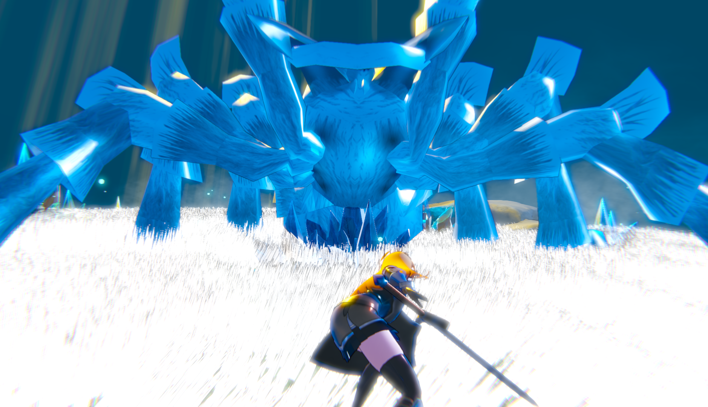
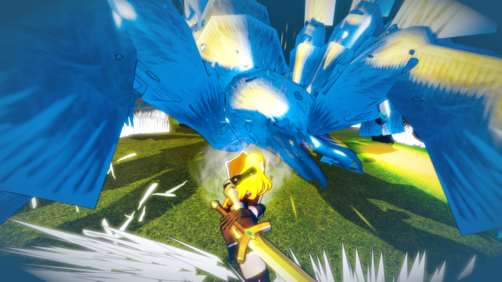

# VEER

「回避を駆使して戦う」をコンセプトとした3Dアクションゲームです。  
「回避・攻撃時の爽快感」「ボスの自然な挙動や存在感」「制作を支える各種エディタ」を重視して制作しています。

| 項目 | 内容 |
|---|---|
| 制作人数 | 1人 |
| 制作開始 | 2026年4月 |
| 使用言語 | C++23 / HLSL / Lua |
| グラフィックスAPI | DirectX 11 |

### 実行ファイルのダウンロードは[こちら](https://github.com/iiiiiinnnnnnnn/VVV/releases/download/Release/Development.zip)から

<table>
  <tr>
    <td></td>
    <td></td>
  </tr>
  <tr>
    <td></td>
    <td></td>
  </tr>
</table>

## 操作方法

| 操作 | キーボード・マウス | コントローラー（Xbox） |
|---|---|---|
| 移動 | WASD | 左スティック |
| カメラ操作 | マウス移動 | 右スティック |
| 攻撃 | 左クリック | B / RT |
| 回避 | Space | A / LT |
| ダッシュ | 左Shift | 左スティック押し込み |
| しゃがみ | Ctrl | 右スティック押し込み |
| カメラ方向の補正 | 右クリック | LB / RB |
| ポーズ | Esc | Menu |

## ビルド環境

- Windows 11 (64-bit)
- Visual Studio 2022
- MSVC v143
- Windows SDK
- DirectX 11対応GPU

### ビルド方法

1. リポジトリをクローンする。
2. `VEER.sln` をVisual Studioで開く。
3. ソリューション構成を `Development`、プラットフォームを `x64` に設定する。
4. ソリューションをビルドする。

## 使用ライブラリ

- DirectXTK
- DirectXTex
- NVIDIA PhysX
- Recast & Detour
- Effekseer
- Dear ImGui
- Lua
- sol2
