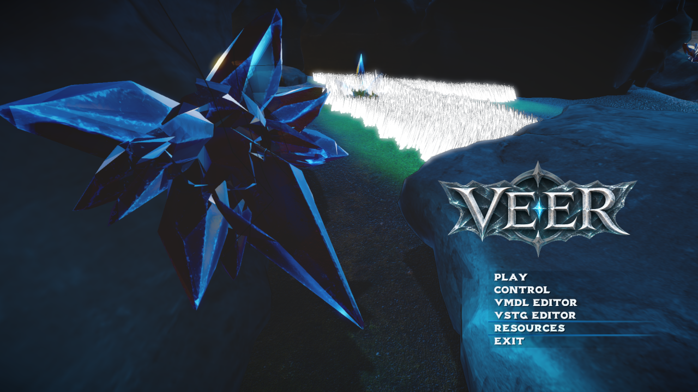
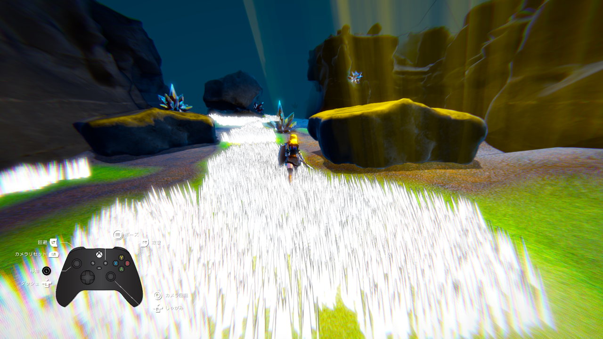

# VEER

## 「回避を駆使して戦う」がコンセプトのゲーム作品です。  
「回避＆攻撃時の実感」「ボスの自然さや存在感」「制作を支える各種エディタ」を重視して制作しています。  
  
【制作人数】　１人  
【制作開始】　２０２６年４月  
【使用言語】　C++ / HLSL / Lua  

<table>
  <tr>
    <td></td>
    <td></td>
  </tr>
  <tr>
    <td></td>
    <td></td>
  </tr>
</table>
